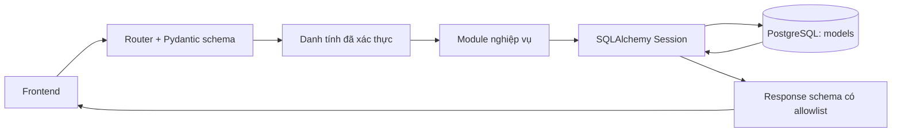
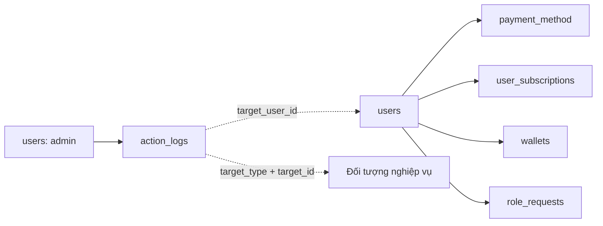
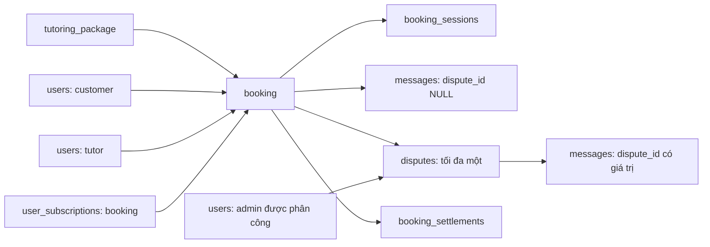
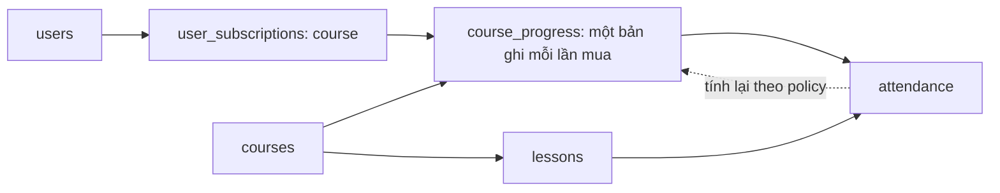
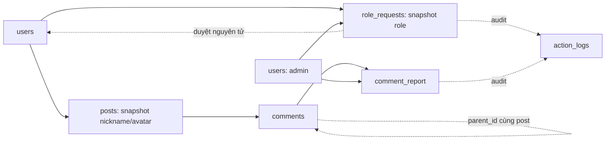
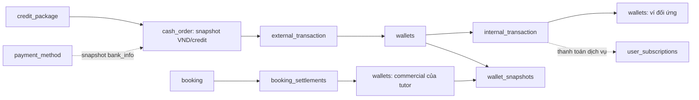
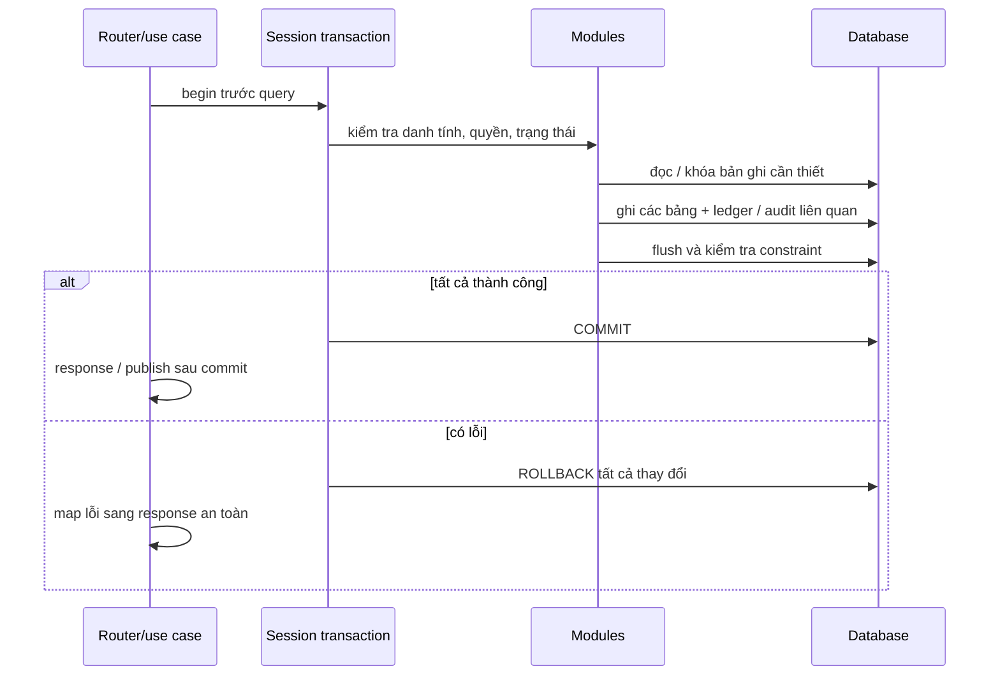

# Luồng dữ liệu trong database

> Các luồng dưới đây là ghi chép thiết kế ban đầu. Xem
> [trạng thái triển khai](implementation.md) và OpenAPI `/api/docs` cho chức năng
> đã hoàn thiện. Các TODO gốc được giữ nguyên.

## Phạm vi hiện tại và đích triển khai

Model mô tả 24 bảng DBML và auth_sessions bổ sung. Module có 24 hàm nghiệp vụ
và 5 hàm auth; ngoài mẫu tin nhắn, báo cáo và audit, auth ghi/cập nhật phiên.
Các luồng thanh toán, đặt gia sư, ghi nhận học tập, nâng role, quyết toán dưới
đây là **thiết kế để triển khai theo TODO**, chưa phải tính năng đã chạy.
Các hàm JWT/refresh/logout đã có code/test nhưng chưa có endpoint production.

Đã có kết nối PostgreSQL local, Session và migration cho 25 bảng. API nghiệp vụ
chưa đăng ký; cài máy mới và đọc/ghi qua Session theo [database-setup.md](database-setup.md).

Sơ đồ trên là kiến trúc đích. Hiện chỉ health API nối frontend và backend;
module nghiệp vụ được gọi trực tiếp trong test, chưa gắn vào router.

## 1. Người dùng, tài khoản ngân hàng và quyền dịch vụ

Mũi tên trong các sơ đồ nhóm biểu diễn quan hệ/liên kết dữ liệu, không có nghĩa
mọi lần đọc bản ghi cha sẽ ghi bản ghi con.

| Thao tác | Đọc | Ghi trong một transaction | Điều kiện cần kiểm tra |
| --- | --- | --- | --- |
| Đăng ký — TODO | Email hiện có | `users`; ví ban đầu nếu policy quy định | Chuẩn hóa email, hash mật khẩu, unique, role/status server quyết định |
| Lưu phương thức thanh toán — TODO | User hiện tại | `payment_method` | Đúng chủ, unique `(user_id, account_number)` |
| Kích hoạt quyền mua — TODO | Dịch vụ/gói, ví, kết quả thanh toán | `user_subscriptions` + booking hoặc course_progress + ledger/ví | Đúng người mua, type khớp, snapshot tên/giá, không cấp quyền trước xác nhận |
| Thao tác admin — có mẫu ghi log | Actor và đối tượng theo nghiệp vụ | Thay đổi đối tượng + `action_logs` | Log cùng transaction; mẫu logger chỉ kiểm tra role, không thay quyền thao tác cụ thể |

Hash mật khẩu đã có hàm mẫu trong `app/core/security.py`: khi hoàn thiện đăng ký,
gọi `hash_password()` trước khi gán `User.password_hash`. Hash đã chứa salt và
tham số Argon2id; không lưu mật khẩu gốc và không log hash. Verify/rehash và
authenticate_user đã có: đọc users, kiểm tra status, gán password_hash mới khi
cần; caller commit cùng tạo phiên auth_sessions. LoginRequest/TokenResponse đã
có nhưng login route còn TODO. Cơ chế JWT Bearer có auth_sessions, refresh rotation và
logout; get_active_user chưa thay kiểm tra JWT/phiên. Xem [luồng auth](security.md#luồng-dữ-liệu-auth).

`ActionLog.target_id` là liên kết đa hình, không phải FK đến tất cả bảng. Service
phải kiểm tra `target_type/target_id`. `admin_id` và `target_user_id` là hai vai
trò khác nhau dù cùng trỏ về `users`.

`user_subscriptions.status=active` chưa đủ để cấp quyền: phải thỏa
`activated_at <= now` và `expired_at IS NULL OR expired_at > now`. Job cập nhật
expired chỉ giúp đồng bộ trạng thái, không thay kiểm tra thời hạn lúc request.
Các mẫu kiểm tra thời hạn đã áp dụng điều kiện này.

## 2. Đặt gia sư, lịch học, tin nhắn và tranh chấp

Luồng chính dự kiến:

1. **Tạo đơn — TODO:** đọc gói active và customer; tạo `booking` cùng ít nhất
   một `booking_sessions`. Nếu chưa chốt lịch thì cả `starts_at` và `ends_at`
   đều NULL. Một transaction bảo đảm không có booking được tạo nửa chừng.
2. **Thanh toán — TODO:** kiểm tra lại giá từ DB, khóa ví/đơn; ghi ledger và số
   dư, tạo subscription loại booking cho customer, liên kết `subscription_id`
   duy nhất. Cần chốt tạo booking trước hay trong cùng giao dịch mua.
3. **Phân công/xếp lịch — TODO:** cập nhật tutor và session; kiểm tra trùng lịch
   cùng cơ chế khóa/constraint phù hợp. Unique `(booking_id, session_no)` không
   tự ngăn hai booking trùng giờ cùng tutor.
4. **Trao đổi — có mẫu gửi text:** xác thực user active thuộc customer/tutor;
   INSERT `messages` với `dispute_id=NULL`. Không tự publish sự kiện trước commit.
   Đọc lịch và đọc tranh chấp bởi hai bên cũng đã có mẫu.
5. **Tranh chấp — TODO:** khóa booking; tạo một `disputes` do người tham gia mở,
   cập nhật booking theo ma trận trạng thái được chốt. Admin được phân công có
   luồng quyền riêng; không được đọc mọi chat chỉ vì có role admin.
6. **Hoàn thành/quyết toán — TODO:** kiểm tra đủ buổi và điều kiện tranh chấp;
   cập nhật booking/subscription và tạo quyết toán theo policy đã chốt. DBML
   ghi quyền booking có thể hết hạn sau một năm kể từ hoàn thành: thời điểm
   bắt đầu/hết hạn phải được service tính tường minh theo quy tắc này.

Trạng thái booking hiện có: `pending`, `confirmed`, `assigned`, `completed`,
`cancelled`, `refunded`, `disputing`. Enum chỉ giới hạn giá trị, **không tự định
nghĩa chuyển trạng thái hợp lệ**; cần chốt bảng actor/trạng thái trước/sau/điều kiện.

Tin nhắn tranh chấp có FK ghép `(dispute_id, booking_id)` để tranh chấp đúng đơn.
Chat thường và chat tranh chấp phải lọc riêng khi đọc. FK không bảo vệ quyền đọc,
không ngăn gửi khi đơn đóng và không kiểm tra file upload; các phần đó còn TODO.

## 3. Mua khóa học, bài học, điểm danh và kết quả

Luồng ghi dự kiến:

1. Đọc `courses` và bảng giá server; thanh toán thành công mới tạo một
   `user_subscriptions(type=course)` và một `course_progress` trong cùng
   transaction với biến động ví/ledger. Mua lại tạo subscription/progress mới,
   không ghi đè lịch sử cũ.
2. Khởi tạo progress 0, `result/completed_at=NULL`; gán `updated_at` tường minh.
   Bài học thuộc course, thứ tự duy nhất `(course_id, order_idx)`.
3. Khi điểm danh/xem bài: kiểm tra quyền còn hạn, lấy course từ progress/lesson,
   upsert `attendance` theo PK `(subscription_id, lesson_id)`. Hai FK ghép qua
   course bảo đảm lesson không bị gắn vào lần đăng ký khóa khác.
4. Ghi attendance và cập nhật progress cùng transaction. Bài VOD không có bài
   tập tính theo thời lượng xem/tổng thời lượng; bài có bài tập dùng xác nhận
   `assignment_completed` của quản trị. Lớp trực tiếp không có bài tập dùng
   điểm danh. `progress_percent` là trung bình tiến độ bài; `attendance_ratio`
   là tỷ lệ bài đã hoàn thành. Không nhận điểm cuối cùng từ client.
5. Khi đạt 100%, ghi `completed_at`. `final_score/result` có thể để NULL khi
   chưa đủ ba điểm. Khi đủ điểm, server tính trung bình giữa kỳ/cuối kỳ/thực
   hành làm tròn half-up; từ 85 excellent, từ 50 good, dưới 50 failed.

Các mẫu hiện có:

- Catalog chỉ trả `courses.status=visible`.
- Người mua còn quyền được đọc lessons kể cả khi course hidden.
- Tiến độ/attendance lịch sử chỉ trả đúng chủ subscription loại course; quyền
  xem lịch sử không đồng nghĩa được lấy media khi subscription hết hạn.
- Chưa có ghi attendance, heartbeat VOD, chấm điểm hoặc cập nhật progress.

## 4. Nội dung cộng đồng, nâng bậc và kiểm duyệt

- **Bài viết/bình luận:** xét `min_role_level` từ role hiện tại trong DB, không
  nhận cấp quyền client khai báo. Comment phải thuộc post và parent cùng post;
  nếu cho đổi parent phải kiểm tra chu trình nhiều cấp ở service. Hàm đọc bài
  và bình luận đã có mẫu, chức năng tạo/sửa/ẩn còn TODO.
- **Báo cáo:** mẫu `report_comment` kiểm tra user active, quyền đọc bài và comment
  chưa ẩn, rồi INSERT report pending. Chưa có rate limit, chống trùng hoặc endpoint.
  Quy trình sau đó: admin nhận xử lý -> khóa report -> kiểm tra phân công -> cập
  nhật approved/rejected + trạng thái comment + log trong một transaction.
- **Nâng role:** lưu `current_role_at_request` từ DB; khi duyệt phải khóa request
  và user, kiểm tra role hiện tại vẫn khớp snapshot, chỉ nâng đúng một bậc và
  xác thực người được phép duyệt bậc đó. Cập nhật request, user và log cùng commit.
  Mẫu hiện tại chỉ đọc lịch sử request của chính user.

Thứ tự bậc: `guest -> member -> student -> trainee_tutor -> tutor -> admin ->
head_admin`. Head admin không có bậc tiếp theo. Enum lưu tên, không lưu số 0–6.

## 5. Nạp/rút, thanh toán nội bộ và quyết toán gia sư

Toàn bộ cập nhật tiền trong phần này còn TODO. Module hiện chỉ đọc dữ liệu thuộc
đúng chủ; không có hàm cộng/trừ tiền hoặc endpoint xác nhận thanh toán.

### Nạp và rút qua bên ngoài

1. Tạo `cash_order(pending)` với wallet/user đúng chủ. Đơn nạp snapshot
   `amount_vnd/credit_amount` từ credit_package active. Đơn rút snapshot
   `bank_info` từ payment_method được kiểm tra quyền.
2. Khi nhận kết quả nhà cung cấp, xác minh chữ ký/reference/số tiền ở server;
   khóa cash_order và ví, kiểm tra chưa xử lý, ghi `external_transaction`, cập
   nhật số dư và success/failed một cách nhất quán. Redirect từ frontend không
   phải bằng chứng thanh toán.
3. Cần chốt cách giữ tiền khi đơn rút pending để cùng số dư không bị dùng hai lần.
   Gọi nhà cung cấp ngoài transaction DB dài; retry cần idempotency và cơ chế
   đối soát/khôi phục giữa hai hệ thống.

### Chi trả dịch vụ và chuyển tiền nội bộ

Đọc gói/dịch vụ từ DB, kiểm tra quyền và khóa các ví theo thứ tự cố định. Cập
nhật nguồn/đích, ghi `internal_transaction` với snapshot số dư trước/sau và tạo
quyền dịch vụ trong cùng transaction. Cả source_wallet_id và destination_wallet_id
đều bắt buộc, vì vậy ví đối ứng nền tảng phải được thiết kế trước.

Không sửa/xóa ledger đã ghi để sửa sai: dùng giao dịch bù và audit. Luồng đọc mẫu
không trả số dư ví đối tác; request chỉ được chọn ví của danh tính đã xác thực.

### Quyết toán và giải ngân

1. Khi booking đủ điều kiện, kiểm tra tutor được gán và ví commercial đúng chủ;
   tạo một `booking_settlements` cho mỗi booking với snapshot commission/phân bổ.
2. Các đẳng thức DB đã bảo vệ:
   `total_amount = platform_fee + tutor_income` và
   `tutor_income = available_amount + hold_amount`. Phần trăm trong 0–100,
   các khoản tiền không âm. Check không thay công thức làm tròn/phân bổ nghiệp vụ.
3. Job đến hạn khóa settlement held và ví, kiểm tra điều kiện, chuyển holding
   sang available, ghi ledger và cập nhật released/actual_released_at cùng commit.
4. Tranh chấp hoàn tiền phải phối hợp settlement, ví, ledger, subscription và
   booking. Nếu tiền đã giải ngân, cần chính sách thu hồi/debt; không tự sửa
   snapshot phân bổ ban đầu để giả lập biến động tiền.

Snapshot ví theo ngày chỉ phục vụ báo cáo/đối soát, không thay ví hoặc ledger làm
nguồn cập nhật số dư. Chốt timezone/ngày nghiệp vụ và ý nghĩa balance_snap trước
khi viết job. Unique `(wallet_id, snapshot_date)` hỗ trợ chạy lại có kiểm soát.

## Transaction là ranh giới của một use case

Không commit riêng trong module con. Lỗi DB làm transaction thất bại phải được
rollback trước khi tiếp tục; không bắt lỗi rồi vẫn trả thành công. Các phần ghi
tiền và chuyển trạng thái cần test retry/cạnh tranh trên PostgreSQL thật; test
SQLite hiện tại chỉ xác minh logic truy cập và rollback của mẫu.

## Các quyết định còn thiếu trước khi viết luồng ghi thật

| Điểm cần chốt | Vì sao schema hiện tại chưa đủ tự quyết định |
| --- | --- |
| Vận hành PostgreSQL production | Local đã có driver/Session/migration; còn cấu hình và vận hành môi trường deploy |
| Timezone và UUID | DB dùng timestamp không timezone, UUID chưa có default sinh tự động |
| Nối auth và ma trận chuyển trạng thái | JWT, verify/authenticate, Session và schema login đã có; còn router/rate limit; enum chưa định nghĩa quyền chuyển trạng thái |
| Idempotency/reference nhà cung cấp | Chưa có khóa unique cho callback, retry mua hàng và giải ngân |
| Quy tắc tiền | int trong ledger nhưng bigint trong ví; phải chốt dấu amount, VND/credit và giới hạn |
| Ví nền tảng | Wallet bắt buộc user_id; internal transaction bắt buộc cả hai ví, chưa có mô hình đối ứng hệ thống |
| Phí, tạm giữ, làm tròn và giải ngân | Check tổng tiền không tự xác định các công thức/tỷ lệ/ngày release |
| Hoàn tiền một phần | Dispute chỉ có verdict, chưa có cấu trúc số tiền hoàn và liên kết nghiệp vụ bù rõ ràng |
| Xếp lịch và xét hoàn thành | Chưa chốt cách chống trùng lịch, điều kiện đủ buổi và công thức điểm/tiến độ |

Giữ nguyên 24 model DBML; auth bổ sung bảng thứ 25 auth_sessions. Các bảng và
thay đổi schema cần đưa qua migration trước khi triển khai.

Xem [module và cách phát triển tiếp](modules.md), [cấu trúc model](models.md).
