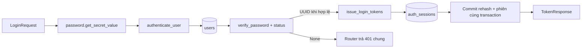
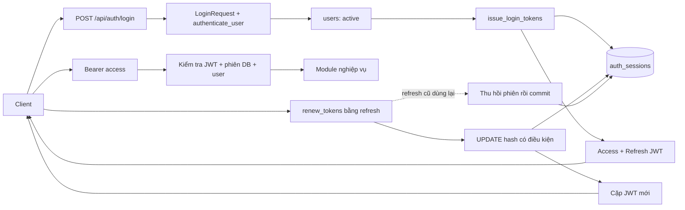

# JWT Bearer, refresh và renew

Ngoài login/refresh/logout/me, đã có register, change-password, change-email,
logout-all, danh sách phiên và thu hồi từng phiên. Đổi email/mật khẩu cần mật
khẩu hiện tại và thu hồi mọi phiên cùng transaction. Frontend lưu cặp token
trong `localStorage` theo origin/API để duy trì đăng nhập khi tải lại hoặc mở
tab mới. Khi khởi động, `/auth/me` xác minh phiên trước khi mở trang cần đăng
nhập. Quyền và trạng thái tài khoản vẫn do backend xác minh ở mỗi request.
Xem [trạng thái triển khai](implementation.md).

Refresh được tuần tự hóa trong mỗi tab và qua Web Locks giữa các tab trên
trình duyệt hỗ trợ. Token mới được lưu sau mỗi lần rotation; sự kiện storage
đồng bộ thay đổi tài khoản/đăng xuất giữa các tab. Lỗi mạng, timeout hoặc 5xx
khi refresh không xóa phiên; refresh bị từ chối bằng 401/403 mới kết thúc phiên.
Đăng xuất xóa thông tin phiên trên trình duyệt kể cả khi API không kết nối được.
Hạn tuyệt đối vẫn theo refresh JWT (mặc định 7 ngày), không tự kéo dài vô hạn.

Nếu trình duyệt chặn storage, phiên dùng bộ nhớ và mất khi tải lại. Storage
có thể được JavaScript cùng origin đọc, nên cần giữ nội dung người dùng ở
dạng text, không đưa script không tin cậy vào origin ứng dụng, và dùng HTTPS
khi deploy. Không lưu mật khẩu hoặc `JWT_SECRET_KEY` trên frontend.

Các test đồng thời trên PostgreSQL xác minh refresh reuse, logout-all và khóa
user không để lại token dùng được sau thu hồi. Mật khẩu không bị strip/normalize.

## Cơ chế đã chọn

API dùng `Authorization: Bearer <access_token>`. Access và refresh là hai loại
JWT ký HS256; không thể dùng refresh làm access hoặc access để renew. JWT chỉ
ký, không mã hóa payload: không đặt mật khẩu hay thông tin riêng tư vào claim.

**Refresh token** là credential dùng để gia hạn; **renew** là hành động dùng nó
để lấy cặp access/refresh mới, không phải một cơ chế gia hạn khác.

| Giá trị | Mặc định | Ý nghĩa |
| --- | --- | --- |
| Access JWT | 900 giây | Quyền gọi API ngắn hạn |
| Refresh JWT | 604800 giây | Hạn tuyệt đối một phiên đăng nhập, tương đương 7 ngày |
| Renew | Refresh dùng một lần | Cấp cặp mới và thay hash refresh hiện hành |
| Logout/reuse | Thu hồi phiên | Mọi access/refresh trong phiên bị từ chối qua kiểm tra DB |

Renew không đẩy hạn cuối phiên thêm 7 ngày; access mới cũng không vượt hạn này.
Access cũ còn dùng được tới khi hết hạn sau renew bình thường. Logout hoặc
reuse thu hồi cả phiên khi request được kiểm tra qua `get_authenticated_user`.

## File và trách nhiệm

| File | Phần đã viết |
| --- | --- |
| `core/security.py` | Hash/verify/rehash Argon2id, tạo cặp JWT, kiểm tra claim/loại, hash refresh |
| `core/config.py` | JWTSettings, đọc secret/issuer/audience/TTL, không có secret mặc định |
| `models/auth_session.py` | Phiên lưu hash refresh, hạn tuyệt đối và thời điểm thu hồi |
| `schemas/auth.py` | LoginRequest/RefreshRequest với SecretStr, TokenResponse và allowlist CurrentUserResponse |
| `modules/auth/authenticate.py` | authenticate_user: chuẩn hóa email, kiểm tra mật khẩu/status, gán hash nâng cấp và trả UUID/None |
| `modules/auth/login.py` | issue_login_tokens: tạo phiên cho user active SAU khi caller xác thực mật khẩu |
| `modules/auth/refresh.py` | renew_tokens: đổi hash nguyên tử, thu hồi phiên khi reuse |
| `modules/auth/current_user.py` | get_authenticated_user: JWT + phiên DB chưa hết hạn/thu hồi + User active |
| `modules/auth/logout.py` | revoke_token_session: thu hồi đúng chủ, gọi lại không gây tác dụng lặp |
| `api/dependencies/auth.py` | HTTPBearer/get_access_claims; thiếu/sai bearer trả 401 và WWW-Authenticate: Bearer |
| `api/routes/auth.py` | POST login/refresh/logout và GET me; commit trước khi trả token hoặc xác nhận logout |
| `core/rate_limit.py` | Giới hạn login theo IP, có khóa bảo vệ truy cập đồng thời và giới hạn số IP lưu trong RAM |

Đường dẫn tính từ `backend/app/`. `get_access_claims` chỉ kiểm tra JWT, **chưa đủ
để bảo vệ endpoint**: phải gọi `get_authenticated_user` với Session để áp dụng
logout, reuse và status user. Quyền sở hữu/phân công do module nghiệp vụ kiểm tra.

Đã có Session, migration và router auth. Dependency get_current_user nối
JWT/phiên/user qua DB. Frontend hiện chưa có form đăng nhập; có thể gọi API qua
`/api/docs` hoặc HTTP client. user_id tự client khai báo không phải xác thực.

## Endpoint đã triển khai

| Method | Đường dẫn | Request | Response thành công |
| --- | --- | --- | --- |
| POST | `/api/auth/login` | JSON `email`, `password` | 200 TokenResponse |
| POST | `/api/auth/refresh` | JSON `refresh_token`, không cần access token | 200 TokenResponse mới |
| GET | `/api/auth/me` | Bearer access token | 200 `id`, `email`, `role`, `status` |
| POST | `/api/auth/logout` | Bearer access token | 204, body rỗng |

Login sai mật khẩu, email không tồn tại, thiếu hash hoặc tài khoản bị khóa đều
trả 401 `Invalid email or password`; refresh bị từ chối trả 401 chung, có
`WWW-Authenticate: Bearer`. Thiếu/sai input trả 422. Logout kiểm tra phiên đang
hoạt động, nên gọi lại bằng token đã thu hồi sẽ trả 401. Response token có
`Cache-Control: no-store` và `Pragma: no-cache`.

Login giới hạn 10 request/IP trong mỗi cửa sổ 60 giây, tính cả lần thành công;
vượt giới hạn trả 429 kèm `Retry-After` trước khi verify mật khẩu. Bộ đếm riêng
cho từng process, tối đa 10.000 IP; khi đầy từ chối IP mới tới khi có cửa sổ hết
hạn. Không đọc trực tiếp `X-Forwarded-For` từ client; reverse proxy cần cấu hình
trusted proxy của server đúng cách. Triển khai nhiều worker/replica cần thêm
rate limit dùng chung ở gateway hoặc kho lưu trữ chung.

Ví dụ đăng nhập qua PowerShell (thay bằng tài khoản đã có trong DB):

```powershell
$credentials = @{ email = "member@example.com"; password = "your-password" } | ConvertTo-Json
$tokens = Invoke-RestMethod -Method Post -Uri http://localhost:8000/api/auth/login -ContentType application/json -Body $credentials
$headers = @{ Authorization = "Bearer $($tokens.access_token)" }
Invoke-RestMethod -Uri http://localhost:8000/api/auth/me -Headers $headers
Invoke-RestMethod -Method Post -Uri http://localhost:8000/api/auth/logout -Headers $headers
```

Chưa có API đăng ký; tài khoản dùng để đăng nhập cần email chuẩn hóa,
password_hash tạo bằng `hash_password` và status active.

## Kiểm tra mật khẩu và hợp đồng login

verify_password(plain_password, hashed_password) trả (valid, updated_hash).
Input rỗng/sai kiểu, hash NULL/không nhận diện hoặc sai mật khẩu trả (False, None).
Mật khẩu giữ nguyên ký tự/khoảng trắng. Hash cần nâng cấp được thư viện trả về
sau verify thành công; không hash lại mật khẩu rồi so hai chuỗi.

authenticate_user nhận Session, chuẩn hóa email strip().lower() và query User.
Nó trả UUID khi mật khẩu đúng và User.status=active; mọi trường hợp bị từ chối
trả None. Khi cần rehash, chỉ gán password_hash, không tự commit. Quy ước đăng
ký/import phải lưu email theo cùng cách chuẩn hóa; email mixed-case có sẵn chưa
được hàm này tự cập nhật hoặc di chuyển.

Luồng login đã triển khai:



LoginRequest.email dùng EmailStr của Pydantic với email-validator==2.3.0, giới hạn
320 ký tự, từ chối email rỗng/toàn khoảng trắng/sai định dạng. Thư viện chuẩn hóa
domain và khoảng trắng bao quanh; authenticate_user tiếp tục áp dụng quy tắc
lowercase của ứng dụng. Đây là validation địa chỉ, không xác minh chủ hộp thư.
Password không rỗng, tối đa 1024 ký tự và dùng SecretStr. RefreshRequest cũng dùng
SecretStr, giới hạn token từ 1 đến 4096 ký tự. TokenResponse có cặp token, token_type=bearer
và cả hai TTL được giới hạn gt=0.
SecretStr che mật khẩu trong repr; token Field(repr=False) chỉ che biểu diễn Python,
JSON response vẫn chứa token. Không log payload mật khẩu hoặc response token.

### Trạng thái các điểm review trước khi nối API

| Mức trước đây | Điểm review | Trạng thái hiện tại |
| --- | --- | --- |
| Vừa | Dummy hash tạo mỗi request | Đã được chuyển lên cấp module; test xác nhận nhánh thiếu user/hash không gọi hash_password lại |
| Vừa | Email mới kiểm tra độ dài | Đã chuyển sang EmailStr, khai báo dependency và kiểm tra email sai/blank, domain normalization và JSON Schema format=email |
| Thấp | TTL response chưa giới hạn dương | Người dùng đã bổ sung Field(gt=0); test xác nhận từ chối 0 và số âm ở cả hai TTL |

Ba điểm review trên đã được xử lý và kiểm tra; router auth đã nối vào ứng dụng.
Test xác thực/rehash và API dùng SQLite trong bộ nhớ, không ghi
dữ liệu vào PostgreSQL thật và chưa đo/tuyên bố xử lý constant-time.

## Cấu hình

Trong `.env` gốc hoặc môi trường backend:

```dotenv
JWT_SECRET_KEY=
```

Chỉ JWT_SECRET_KEY bắt buộc cho JWT. Issuer tutor-web, audience tutor-web-api,
access 900 giây và refresh 604800 giây đã có mặc định trong code. Chỉ thêm
JWT_ISSUER/JWT_AUDIENCE/JWT_ACCESS_TTL_SECONDS/JWT_REFRESH_TTL_SECONDS khi muốn đổi.

Tạo secret riêng cho môi trường và điền JWT_SECRET_KEY:

```powershell
.\backend\.venv\Scripts\python.exe -c "import secrets; print(secrets.token_urlsafe(48))"
```

Secret phải có ít nhất 32 byte, không dùng test key hoặc prefix VITE_. Process
environment ưu tiên hơn `.env`. Thuật toán cố định HS256, không lấy từ header
client. Auth thiếu key sẽ từ chối cấu hình; health công khai vẫn chạy. Đổi key
làm token ký bằng key cũ không còn hợp lệ.

JWTSettings và TokenPair che key/token trong repr. Không log body refresh, header
Authorization hay response token; dùng HTTPS khi deploy.

## Claims và kiểm tra

Token có `sub` (UUID user), `sid` (UUID phiên), `jti` (UUID token), `type`, `iss`,
`aud`, `iat`, `nbf`, `exp`. Header typ là `at+jwt` hoặc `rt+jwt`. Decoder yêu cầu
đủ claim, đúng issuer/audience/chữ ký/thời hạn, timestamp nguyên và UUID hợp lệ.
Role không dùng làm claim cấp quyền lâu dài: lấy role/status hiện tại từ DB.

## Luồng dữ liệu auth



Một lần đăng nhập là một AuthSession/token family. Thiết bị khác có phiên khác;
logout phiên này không tự logout tất cả thiết bị.

DB lưu SHA-256 của toàn bộ refresh JWT, không lưu token gốc. Đây là digest của
token có độ ngẫu nhiên cao; mật khẩu vẫn hash bằng Argon2id.

Renew dùng UPDATE có điều kiện `id/user_id/hash cũ/revoked_at/expiry` và RETURNING.
Chỉ request đổi được hash hiện hành nhận cặp mới. JWT refresh hợp lệ nhưng hash
không còn hiện hành sẽ thu hồi phiên. Client chỉ chạy một refresh request tại
một thời điểm và thay cả hai token khi thành công. Refresh đồng thời có thể bị
coi là reuse; mất response sau commit yêu cầu đăng nhập lại, chưa có grace window.

## Transaction khi renew bị từ chối

Không raise 401 trong transaction vừa ghi thu hồi: exception sẽ rollback quyết
định đó. renew_tokens trả RenewalResult để caller lưu kết quả trước rồi map lỗi:

```python
from fastapi import HTTPException
from app.modules.auth.refresh import renew_tokens

# Session đã cấu hình; refresh_token lấy từ request schema, không log body.
with session.begin():
    result = renew_tokens(session, refresh_token, jwt_settings)
# Rotation hoặc revocation khi reuse đã commit.
if result.tokens is None:
    raise HTTPException(401, "Invalid refresh token", headers={"WWW-Authenticate": "Bearer"})
# Chuyển result.tokens sang response schema; chỉ trả sau commit thành công.
```

Lỗi DB thực sự phải rollback và không trả token. Login/logout cũng cần commit
trước response. Không dùng Session chung giữa request.

## Schema mới cần migration

auth_sessions bổ sung ngoài 24 bảng DBML:

| Cột | Kiểu/ràng buộc |
| --- | --- |
| id | UUID PK, khớp sid |
| user_id | UUID FK users.id, bắt buộc |
| refresh_token_hash | varchar(64), bắt buộc |
| created_at, expires_at | timestamptz, bắt buộc, expires_at > created_at |
| revoked_at | timestamptz nullable |

Index `(user_id, revoked_at)` phục vụ thu hồi; index expires_at phục vụ cleanup.
Auth dùng timezone-aware UTC, không sửa timestamp của 24 model DBML cũ. Metadata
hiện có **25 bảng, 15 enum**, đã tạo và kiểm tra trên PostgreSQL 18 local.

## Tiếp tục triển khai

1. PostgreSQL/Session/migration đã có và không tự create_all trong startup.
   Khi đổi máy chạy [setup](database-setup.md). Test concurrency renew/reuse/logout trên PostgreSQL.
2. Login/refresh/logout/me, verify/rehash, dummy hash và rate limit theo IP đã có.
   Bổ sung MFA nếu chọn và rate limit dùng chung khi chạy nhiều process.
3. CORS đã cho POST và Authorization. Frontend cần nối form đăng nhập và
   quản lý phiên; chưa bật cookie auth/refresh.
4. Thêm logout_all/reset_password/khóa user thu hồi mọi phiên, cleanup, chính sách
   lưu token phía client. Test SQLite hiện tại chưa thay concurrency test thật.

Đã smoke test rotation/reuse/rollback trên PostgreSQL thật. Nếu dependency auth
đã query Session, transaction đã autobegin: endpoint dùng commit tường minh thay
vì begin lồng. Refresh không yêu cầu access còn hạn; commit quyết định thu hồi
trước khi trả 401. Xem [quy ước Session](database-setup.md#session-và-transaction-trong-endpoint).

## Tài liệu tham chiếu

- [PyJWT: ký và kiểm tra registered claims](https://pyjwt.readthedocs.io/en/stable/usage.html).
- [FastAPI: HTTPBearer](https://fastapi.tiangolo.com/reference/security/#fastapi.security.HTTPBearer).
- [RFC 9700 §4.14.2: refresh rotation và xử lý replay](https://www.rfc-editor.org/rfc/rfc9700.html#section-4.14.2).
